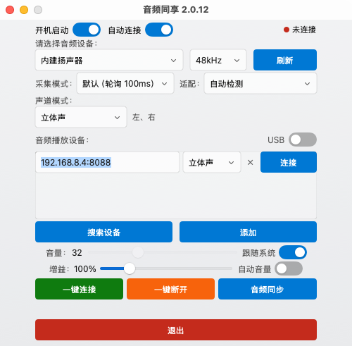

# AudioShare for macOS

macOS 原生版 AudioShare，基于 [Kezry/OpenAudioShare](https://github.com/Kezry/OpenAudioShare) 的 Windows 实现和 Android 端协议重写。

把 Mac 的系统音频实时传输到同一局域网或 USB 连接的 Android 播放设备。协议、APK、UDP 发现和 TCP 控制命令与现有 Android 端保持兼容。

## 系统要求

- macOS 14.2 或更高版本（Core Audio Tap）
- Apple Silicon 或 Intel Mac
- 本地未签名构建；不需要 Mac App Store 沙盒

## 构建

```bash
cd macos
# 可选：下载 adb 和 AudioShare.apk（USB 自动安装需要）
./scripts/fetch-resources.sh

./scripts/build-app.sh
open build/AudioShare.app
```



`Resources/adb` 和 `Resources/AudioShare.apk` 不提交进仓库，运行 `scripts/fetch-resources.sh` 自动下载；不下载也可以使用 Wi-Fi 串流。

安装到应用程序目录：

```bash
cp -R build/AudioShare.app /Applications/AudioShare.app
open /Applications/AudioShare.app
```

首次运行前/后，在：

**系统设置 → 隐私与安全性 → 仅系统录音**（英文系统为 **System Audio Recording Only**）

中允许 **AudioShare**。如果没有看到该应用，点击 `+` 选择 `/Applications/AudioShare.app`。授权后重新连接播放设备即可。

> 这是独立于“屏幕录制”的权限。应用不需要、也不会申请屏幕录制权限。

## 功能

- Wi-Fi 设备自动发现（UDP 58261–58270）和手动添加 IP/端口
- 多设备同时连接，设备级音量、延迟测量与音频同步
- USB ADB 连接、自动安装 APK、`localabstract:picapico-audio-share` 端口转发
- 2.0 / 2.1 / 5.1 / 7.1 声道模式及每设备声道指派
- 增益、自动音量（AGC）、跟随系统音量
- 采集模式/驱动适配选项（macOS 映射为缓冲大小与 AGC 参数）
- 开机启动、菜单栏常驻（不显示 Dock 图标）、断线通知与重新连接
- 中英双语、深色/浅色外观、透明窗口
- 与现有 `AudioShare.apk` 完全兼容，无需修改 Android 端

### 多声道说明

立体声输出设备使用全局系统 Tap（兼容性最好）。当所选输出设备本身配置为 5.1/7.1 时，应用会使用设备级 Tap 并保留其声道布局。若输出设备只有 2 声道，5.1/7.1 选项会降级为可用声道，界面上会显示提示。

要获得真正的 5.1/7.1，需要 Mac 的输出设备（HDMI 功放、专业声卡或多声道虚拟设备）本身配置为多声道。后续可以增加可选虚拟 HAL 驱动后端。

## 目录结构

```
macos/
  Sources/AudioShareCore/     协议、设置、声道映射、AGC（可独立测试）
  Sources/AudioShareMac/
    Audio/                    Core Audio 设备枚举与 Tap 采集
    Network/                  TCP 协议、UDP 发现、ADB
    System/                   通知、登录项、权限、本地化、日志
    UI/                       SwiftUI Fluent 界面
  Resources/                  Info.plist、图标；adb/APK 由脚本下载
  scripts/fetch-resources.sh  下载 adb 和上游 APK
  scripts/build-app.sh        构建并生成 .app
  scripts/install.sh          构建并安装到 /Applications
  docs/screenshot.png         UI 截图
```

## 调试

```bash
# 列出音频输出设备
build/AudioShare.app/Contents/MacOS/AudioShare --list-audio

# 采集 6 秒并打印峰值（需要系统录音权限）
build/AudioShare.app/Contents/MacOS/AudioShare --probe <device-uid>

# 把窗口内容渲染为 PNG（不需要屏幕录制权限）
build/AudioShare.app/Contents/MacOS/AudioShare --render

# 直接缓存窗口视图（含原生标题栏）
build/AudioShare.app/Contents/MacOS/AudioShare --snapshot
```

日志：`~/Library/Logs/AudioShare/AudioShare.log`  
设置：`~/Library/Application Support/AudioShare/audio.share.config.json`

## 已知限制

- 多声道是否可用取决于 macOS 输出设备的实际声道布局。
- macOS 的系统录音授权没有公开的“预检查”API；如果授权后仍无声，请关闭再打开开关并重启应用。
- 当前构建使用 ad-hoc 签名，适合本机使用。分发给其他用户需要 Developer ID 签名和公证。
- Android 端继续使用上游 APK；本项目不修改 Android 代码。

## 许可

本项目基于 OpenAudioShare（MIT License）重写，macOS 端代码沿用同一许可证。
